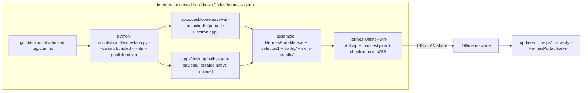

# 02 - Offline Installer Architecture

**Project:** Hermes Desktop Offline Installer (`D:\dev\hermes-desktop-offline`)
**Target:** Windows 10 and 11 x64, fully runnable with **no Internet access** after the ZIP is transferred. Portable folder install - no MSIX, no signing, no registry writes.
**Upstream source:** `D:\dev\hermes-agent` (NousResearch/hermes-agent), tag `v0.22.5`, Electron `44.9.3`, pinned CPython `3.14.9+20261021`, Node `26.12.1`, npm `12.0.2` (all pinned in `pm/lock.json`).
**Builds on:** the findings in [01_investigation.md](./01_investigation.md) - the official MSIX path is unusable offline (ATS signing cert + Windows 11 22621 floor), so the portable `--dir` output is the only viable artifact.

This document defines the four subsystems: the **build pipeline**, the **payload layout**, the **update mechanism**, and the **offline feature matrix**.

---

## 1. Design in one picture



Two invariants drive everything:

1. **Nothing is downloaded at runtime.** Every interpreter, wheel, skill, icon and frontend product is baked into the ZIP on the build host. The offline machine never runs `pip`, `npm`, `uv`, or electron-updater.
2. **The app folder stays unpackaged.** We use `electron-builder --dir`, so the result is a plain folder (`win-unpacked`) that can be copied, relocated, and re-versioned by a script - no MSIX identity, no Store, no signing, no registry entries.

---

## 2. Build pipeline (internet-connected host)

### 2.1 Prerequisites on the build host

| Requirement | Source |
|---|---|
| Clean git checkout at an admitted revision | `scripts/bundles/desktop_prepare.py::require_source` refuses a dirty tree |
| PM toolchain cache | `.cache/desktop-inputs/tools/` - `python-3.14.9+20261021-win32-x64`, `node-26.12.1-win32-x64`, `npm-12.0.2-win32-x64` |
| Build job scratch | `.build/desktop-job/` (must be separate from the cache; enforced by `BuildRequest.create`) |
| Node | `engines` requires `^22.22 \|\| ^24.11 \|\| >=26`. The build host (WindyPC) has Node 22.15.1, so either upgrade Node or let `pm` supply the pinned Node 26.12.1 from `pm/lock.json` |
| Memory | electron-builder asar needs `--max-old-space-size=16384` (available on the build host) |
| Network | Only for `git archive`, npm/uv resolution, and the CPython/Node artifact downloads recorded in `pm/lock.json` |

### 2.2 Step 1 - build the portable unpackaged app

```powershell
cd D:\dev\hermes-agent
python scripts/bundles/desktop.py `
  --tag v0.22.5 `
  --variant bundled `
  --clean `
  -- --dir --publish=never
```

`scripts/bundles/desktop.py` runs, in order:

1. `run-electron-builder.mjs --validate-only` - config sanity check.
2. `scripts/build/node-deps.mjs` - npm dependency preparation for workspaces `apps/desktop`, `ui-tui`, `web` (variant `light` would drop `ui-tui` and `web`).
3. `scripts/generate_icons.py` - flavored icon set into `apps/desktop/build/products/icons`.
4. `scripts/build/tui.mjs` and `scripts/build/web.mjs` - prebuilt frontend products into `build/products/tui` and `build/products/web`.
5. Native payload assembly (`scripts/bundles/native.py` / `native_prepared.py`) - produces `apps/desktop/build/agent-payload/`.
6. `apps/desktop/scripts/write-build-stamp.mjs` - bakes `build/install-stamp.json`.
7. `scripts/build/desktop.mjs` - compiles the Electron main + renderer into `apps/desktop/dist`.
8. `scripts/run-electron-builder.mjs --dir` - assembles the unpackaged folder.

`--dir` is explicitly recognised by `run-electron-builder.mjs` (`if (args.includes('--dir')) return ['dir']`), which suppresses the MSIX/DMG/AppImage targets and therefore the signing and notarization chain. `--publish=never` prevents any feed upload. Only `--dir`, `--publish=never` and `--` are admitted after the `--` separator; any other electron-builder flag is rejected by `run-electron-builder.mjs`.

**Naming.** `product-identity.cjs` is the single source of every name-shaped value. For `--variant bundled` at a stable tag: `displayName = "Hermes Agent"`, `appNamePascal = HermesBundled`, `windowsExecutableName = "Hermes Agent"` (the kebab suffix is empty for a tag build, so the executable is the display name, not `hermes.exe`). Commit or canary builds get `kebabSuffix = -<7 chars>` and therefore `hermes-<7char>.exe`. `desktop_prepare.py` additionally rejects reserved Windows names (`con`, `nul`, `com1`...) and trailing dots/spaces.

**Output:** `apps/desktop/release/win-unpacked/`

```text
win-unpacked/
  Hermes Agent.exe                # renamed electron.exe; win.executableName = windowsExecutableName
  resources/
    app.asar                      # dist/**, assets/**, public/**, package.json
    app.asar.unpacked/            # **/*.node, **/prebuilds/**, dist/**  (asar.unpack)
    agent-payload/                # extraResources, present only for variant bundled/store
    install-stamp.json            # extraResources: build/install-stamp.json
    icon.ico
    update-relaunch-waiter.ps1    # win extraResources
  locales/  *.pak  snapshot/  chrome_origins.json
```

There is no separate identity `.dll`: `scripts/after-extract.mjs` stamps the icon and version into the `.exe` itself with `scripts/set-exe-identity.mjs` (resedit), on the pristine `electron.exe` before ASAR integrity rewrites the PE. If that stamp fails the build continues with the stock Electron icon.

`apps/desktop/electron/payload-backend.ts` resolves the runtime at `<resourcesPath>\agent-payload`, so the folder must keep `agent-payload/` beside `app.asar`.

### 2.3 Step 2 - assemble the offline payload

`scripts/build-offline.ps1` (this repo) copies the two build products into the staging tree defined in section 3:

| Source on build host | Destination in ZIP |
|---|---|
| `apps/desktop/release/win-unpacked/` | `app/` |
| `apps/desktop/build/agent-payload/` | `runtime/` |
| `hermes-agent/skills/`, `optional-skills/`, `plugins/`, `locales/`, `optional-mcps/` | `skills-bundle/` |
| `config/config.yaml.template`, `config/hermes-portable.ini` | `config/` |
| `installer/HermesPortable.exe`, `installer/setup.ps1` | `launcher/` |
| `docs/OFFLINE-QUICKSTART.md` | `docs/` |

The `agent-payload` layout produced by the PM builder is already the runtime layout we want; the assembler renames nothing inside it, only its container.

### 2.4 Step 3 - produce the versioned ZIP

```text
Hermes-Offline-0.0.0-win-x64.zip
├── manifest.json
├── checksums.sha256
├── app/            runtime/        skills-bundle/        config/        launcher/        docs/
```

`manifest.json` is the contract consumed by `update-offline.ps1`:

```json
{
  "schemaVersion": 1,
  "version": "0.0.0",
  "channel": "stable",
  "commit": "<40-char sha>",
  "builtAt": "2026-10-29T00:00:00Z",
  "target": "win32-x64",
  "electron": "44.9.3",
  "python": "3.14.9+20261021",
  "components": {
    "app":           { "path": "app",           "sha256": "...", "required": true },
    "runtime":       { "path": "runtime",       "sha256": "...", "required": true },
    "skills-bundle": { "path": "skills-bundle", "sha256": "...", "required": false },
    "config":        { "path": "config",        "sha256": "...", "required": true },
    "launcher":      { "path": "launcher",      "sha256": "...", "required": true }
  },
  "sizeBytes": 0,
  "signature": "<detached signature, optional>"
}
```

`checksums.sha256` is a one-line-per-file list (`<sha256>  <relative/path>`) covering every file in the ZIP, used by the verifier in section 5.

---

## 3. Payload layout on the offline machine

Default install root: `D:\HermesPortable` (chosen by the wizard in section 3.3; anything writable works).

```text
D:\HermesPortable\
│
├── HermesPortable.exe                  # launcher stub: reads hermes-portable.ini, sets env, starts app\Hermes Agent.exe
├── setup.ps1                           # first-run wizard (paths, profile, provider, offline mode)
├── manifest.json                       # version + component digests of the installed build
├── README-OFFLINE.md
│
├── app\                                # unpackaged Electron app (electron-builder --dir output)
│   ├── Hermes Agent.exe
│   ├── resources\
│   │   ├── app.asar
│   │   ├── app.asar.unpacked\
│   │   ├── install-stamp.json          # payload: "bundled", runtime paths baked in
│   │   ├── icon.ico
│   │   └── agent-payload\             # materialized copy of runtime\ (see 3.1)
│   └── locales\, *.pak, snapshot\
│
├── runtime\                            # the sealed native agent runtime (== build/agent-payload)
│   ├── hermes-agent\                   # git-archive snapshot of the admitted revision
│   │   ├── hermes_cli\  agent\  tools\  providers\  hermes\  gateway\
│   │   ├── hermes_constants.py  pyproject.toml
│   │   └── (tests, tests-js, website, evals, .github, nix, docker, apps, ui-tui, web, scripts EXCLUDED)
│   ├── venv\Lib\site-packages\         # all wheels pre-installed for win32-x64
│   │   └── hermes-agent.pth            # puts the snapshot on sys.path
│   ├── pm-runtime\
│   │   ├── pm-runtime.json             # { "python": "...", "sitePackages": "Lib/site-packages" }
│   │   ├── pyvenv.cfg                  # home = relative path into the tool store
│   │   └── Scripts\                    # CWD-bound redirectors rewritten to relative links
│   ├── tools\                          # PM tool store + tools/facts.json (verified digests)
│   │   ├── python-3.14.9+20261021-win32-x64\   # pinned CPython (python-build-standalone, install_only)
│   │   │   └── python.exe  DLLs\  Lib\  include\
│   │   ├── node-26.12.1-win32-x64\  npm-12.0.2-win32-x64\  uv-0.13.5-win32-x64\
│   │   ├── ripgrep-15.2.0-win32-x64\  git-2.53.0+3-win32-x64\  gh-2.97.0-win32-x64\
│   │   ├── ffmpeg-9.0.1-win32-x64\  chromium-1208\
│   │   └── llamacpp-{cpu,cuda,hip,vulkan}-11671-win32-x64\   # local inference engines, offline-capable
│   ├── bin\                            # hermes.exe, hermes-agent.exe, hermes-acp.exe (minted launchers)
│   ├── uv-cache\                       # retained so a later offline re-seal needs no network
│   ├── enabled-features.json
│   └── manifest.json
│
├── skills-bundle\
│   ├── skills\                         # apple, creative, devops, email, media, note-taking,
│   │                                   # productivity, research, social-media, software-development, web
│   ├── optional-skills\
│   ├── plugins\
│   ├── locales\
│   ├── optional-mcps\
│   └── index-cache\                    # skill search index, prebuilt so first launch needs no crawl
│
├── config\
│   ├── config.yaml.template            # DEFAULT_CONFIG-shaped seed
│   ├── hermes-portable.ini             # launcher + data-path configuration (see 3.3)
│   ├── .env.example                    # keys only, never populated by the build
│   └── providers.local.yaml            # loopback provider presets (Ollama, LM Studio, llama.cpp)
│
├── data\                               # created by setup.ps1; HERMES_HOME lives here
│   ├── config.yaml  .env  state.db  auth.json
│   ├── profiles\  cron\  backups\  home\
│   └── logs\
│
├── updates\                            # incoming ZIPs staged by update-offline.ps1
│   └── Hermes-Offline-0.0.1-win-x64.zip
└── backups\
    └── 0.0.0-20261029T000000Z\         # pre-update snapshot of app\ + runtime\ + manifest.json
```

### 3.1 Why both `app\resources\agent-payload` and `runtime\` exist

`runtime\` is the **canonical, human-editable** copy. `app\resources\agent-payload\` is what Electron actually reads, because `bundledPayload()` hard-codes `path.join(resourcesPath, 'agent-payload')` and the install stamp's `runtime.repoDir`, `runtime.toolsDir`, `runtime.storePython`, `runtime.sitePackages`, `runtime.commands.*` are all **relative to that root**.

Two supported strategies, chosen by `hermes-portable.ini`:

| `payload_placement` | Behaviour |
|---|---|
| `copy` (default) | `runtime\` is copied into `app\resources\agent-payload\` at install time. Self-contained, survives drive ejection, costs disk. |
| `junction` | `app\resources\agent-payload` is a Windows junction to `..\..\runtime`. Saves one payload copy. `update-offline.ps1` must re-create the junction after each swap. |

Junctions are only allowed when the install root is on a local NTFS drive; `setup.ps1` refuses them on network or FAT volumes, because the sealed payload treats escaped links as a build error (`native_prepared.py::_check_links`).

### 3.2 Launch contract

The launcher resolves everything from `hermes-portable.ini`, then invokes the sealed payload:

```ini
; config/hermes-portable.ini
[paths]
install_root      = D:\HermesPortable
data_root         = D:\HermesPortable\data          ; -> HERMES_HOME
work_root         = D:\HermesPortable\work          ; agent working directory
cache_root        = D:\HermesPortable\cache
payload_placement = copy                            ; copy | junction

[runtime]
hermes_cli        = runtime\bin\hermes.exe
python            = runtime\python\python.exe
site_packages     = runtime\venv\Lib\site-packages
repo              = runtime\hermes-agent

[offline]
mode              = strict                          ; strict | lan | permissive
local_base_url    = http://127.0.0.1:11434/v1      ; Ollama / LM Studio / llama.cpp server
local_model       = qwen3:14b
gateway_port      = 8787                            ; loopback only
allow_lan         = false
```

Equivalent environment the launcher exports before starting `app\Hermes.exe`:

```powershell
$env:HERMES_HOME            = "<data_root>"
$env:HERMES_RUNTIME_DIR     = "<install_root>\runtime"
$env:HERMES_BUNDLED_SKILLS  = "<install_root>\skills-bundle\skills"
$env:HERMES_OPTIONAL_SKILLS = "<install_root>\skills-bundle\optional-skills"
$env:HERMES_BUNDLED_PLUGINS = "<install_root>\skills-bundle\plugins"
$env:HERMES_BUNDLED_LOCALES = "<install_root>\skills-bundle\locales"
$env:HERMES_OPTIONAL_MCPS   = "<install_root>\skills-bundle\optional-mcps"
$env:PYTHONUTF8             = "1"
$env:HERMES_OFFLINE         = "1"
```

`HERMES_HOME` is the only data-path seam: `hermes_constants.py` resolves the home as *context override -> `HERMES_HOME` -> platform default* (`%LOCALAPPDATA%\hermes` on Windows). Pointing it at `data\` keeps every state file (`config.yaml`, `.env`, `state.db`) inside the portable folder, which is what makes the whole install relocatable.

### 3.3 `HermesPortable.exe` + `setup.ps1` wizard

`HermesPortable.exe` is a thin, dependency-free stub (statically linked, no .NET runtime assumption) whose only jobs are:

1. Read `config\hermes-portable.ini` (fall back to shipped defaults if absent).
2. On first run, or with `--setup`, invoke `powershell -NoProfile -ExecutionPolicy Bypass -File setup.ps1`.
3. Export the environment from section 3.2 and spawn `app\Hermes.exe`.

`installer\setup.ps1` is the wizard for custom data/work paths. It is idempotent and offline-only:

| Step | Action |
|---|---|
| 1 | Detect install root from `$PSScriptRoot`; verify `manifest.json` digests against `checksums.sha256` |
| 2 | Prompt for `data_root`, `work_root`, `cache_root` (default `<install_root>\data`, `\work`, `\cache`) |
| 3 | Create the directories; refuse a path that is a symlink/junction or inside `app\` |
| 4 | Seed `data\config.yaml` from `config\config.yaml.template` **only if absent** (never overwrite a user config) |
| 5 | Ask for the local model endpoint (`127.0.0.1:11434`, LM Studio `:1234`, llama.cpp `:8080`) and write `model.provider` / `model.base_url` into `data\config.yaml` |
| 6 | Materialize the payload (`copy` or `junction` per 3.1) |
| 7 | Run `scripts\verify-offline.ps1` and print the readiness report |
| 8 | Write `config\hermes-portable.ini` with the resolved absolute paths |

`--reset-paths` re-runs only steps 2 and 8 without touching the payload.

---

## 4. Update mechanism

### 4.1 `scripts/build-offline.ps1` (build host)

```powershell
.\scripts\build-offline.ps1 -Tag v0.0.0 -Variant bundled -Out .\artifacts
```

Pipeline:

1. `git -C D:\dev\hermes-agent fetch --tags` and confirm the tag object exists.
2. Run `python scripts\bundles\desktop.py --tag <Tag> --variant bundled --clean -- --dir --publish=never`.
3. Stage the tree from section 2.3 into `artifacts\stage\`.
4. Compute per-file SHA-256 -> `checksums.sha256`; compute per-component digests -> `manifest.json`.
5. Compress deterministically: `Hermes-Offline-<version>-win-x64.zip` (sorted entry order, fixed timestamps).
6. Emit `artifacts\Hermes-Offline-<version>-win-x64.zip` plus a sidecar `<name>.manifest.json` so the ZIP can be copied alone and the manifest re-attached.

Naming is fixed: `Hermes-Offline-<semver>-<target>.zip`. `update-offline.ps1` parses the version from the filename **and** from `manifest.json`, and fails if they disagree.

### 4.2 `scripts/update-offline.ps1` (offline machine)

```powershell
.\update-offline.ps1 -Zip .\updates\Hermes-Offline-0.0.1-win-x64.zip
```

Sequence, all local:

1. **Preflight** - read the current `manifest.json`; parse the incoming manifest; require `schemaVersion` match and `target` equality. Refuse a downgrade unless `-Force`.
2. **Integrity** - extract to `updates\<version>\` (staging), verify every file against `checksums.sha256`. Abort on any mismatch.
3. **Quiesce** - stop `Hermes.exe` / `hermes.exe` processes; wait for the gateway port to close.
4. **Backup** - snapshot `app\`, `runtime\`, `manifest.json` into `backups\<old-version>-<utc>\`. `data\` is *not* backed up here (Hermes' own `hermes_cli/backup.py` owns that).
5. **Apply** - replace component-by-component in dependency order: `runtime\` -> `app\` -> `skills-bundle\` -> `launcher\`. `config\` is merged, never overwritten: templates are refreshed, `hermes-portable.ini` and `data\config.yaml` are left alone.
6. **Re-seal** - re-materialize `app\resources\agent-payload` (copy or junction), rewrite the payload paths in `install-stamp.json` if the layout moved.
7. **Verify** - run `scripts\verify-offline.ps1`; on failure, roll back from the backup and report.
8. **Record** - write the new `manifest.json`, append to `updates\history.log`.

`-Component app|runtime|skills|launcher` allows partial updates; the manifest's per-component digest makes it safe to ship only a changed component.

### 4.3 What is *not* an update path

The desktop `electron-updater` feed (`publish` in `electron-builder.config.cjs`, R2 or GitHub generic provider) is disabled in offline builds: `--publish=never`, and the install stamp carries no channel. The launcher sets `HERMES_OFFLINE=1`, and the app must treat any updater check as "no update available" rather than a network error. Updates arrive **only** through the ZIP and `update-offline.ps1`.

---

## 5. Verification tooling

`scripts\verify-offline.ps1` is run by the wizard and after every update. It checks, without any network:

| Check | Command |
|---|---|
| Payload integrity | every file matches `checksums.sha256` |
| Interpreter boots | `runtime\python\python.exe -I -S -c "import sys; print(sys.version)"` |
| Import closure | `PYTHONPATH=<repo>;<site-packages> python -c "import hermes_cli.main, agent, tools"` |
| Launch contract | `runtime\pm-runtime\pm-runtime.json` resolves to real files and directories |
| Skills | `skills-bundle\skills\index-cache` present and non-empty |
| Config | `data\config.yaml` parses, `model.base_url` is loopback |
| Stray network defaults | scan the active provider config for non-loopback `http://` / `https://` endpoints |

---

## 6. Offline feature matrix

### 6.1 Works with no network

| Feature | Mechanism | Notes |
|---|---|---|
| Electron desktop UI | `app\` ships prebuilt `dist/**` | Renderer and main are compiled on the build host |
| TUI and web frontends | `runtime\hermes-agent\hermes_cli\tui_dist`, `web_dist` | Built by `scripts/build/tui.mjs` / `web.mjs` and baked into the snapshot |
| Agent core, state, sessions | `runtime\hermes-agent\hermes_state_*.py`, `state.db` | SQLite, local file I/O |
| Terminal / file / process tools | `tools\` in the snapshot | Local execution only |
| Memory and todo tools | `toolsets.py` `memory`, `todo_list` | Persisted under `HERMES_HOME` |
| Skills | `skills-bundle\` + `HERMES_BUNDLED_SKILLS` | Skill *content* is offline; a skill that shells out to a network service still needs that service |
| Plugins, locales, optional MCPs | `HERMES_BUNDLED_PLUGINS`, `HERMES_BUNDLED_LOCALES`, `HERMES_OPTIONAL_MCPS` | Pre-baked, no catalog fetch |
| Cron / scheduled runs | `data\cron\jobs.json`, `executions.db` | Local scheduler |
| Approvals / allowlists | `data\config.yaml` `command_allowlist` | Local policy |
| Backups and restore | `hermes_cli/backup.py` | Writes to `data\backups` |
| LLM inference | `model.base_url` -> `127.0.0.1` (Ollama, LM Studio, llama.cpp server) | Model weights must be downloaded on the build host and shipped in `runtime\models\` or installed before the air gap |
| Vision / auxiliary tasks | `auxiliary.vision.provider` pointed at the local model | Cloud aux fallback is disabled in `strict` mode |
| Browser tool against localhost | Chromium auto-spawn for LAN/localhost URLs | Only when `allow_lan = true` |
| Loopback gateway | `gateway_port = 8787` | Same-machine clients only |

### 6.2 Requires internet (degrades, never crashes)

| Feature | Why | Offline behaviour |
|---|---|---|
| Cloud model providers (OpenRouter, Anthropic, Google, Bedrock, Kimi, Xiaomi, Mistral, Groq, Cerebras) | Remote API | `strict` mode refuses them; the wizard selects a loopback provider |
| `web_search`, `web_extract` (`toolsets.py` `web`) | External search/HTTP | Tool returns a clear "offline" error; the toolset is auto-hidden |
| electron-updater / release feed | R2 or GitHub provider | Disabled; updates via ZIP only |
| MCP servers with remote endpoints | Remote transport | Only `stdio` and loopback servers admitted |
| Model weight download | Requires the registry | Weights shipped in the ZIP or pre-installed |
| Code signing / notarization | Build-host only | Offline builds are unsigned; `setup.ps1` warns about SmartScreen |
| Telemetry / analytics | Remote | Disabled by default |
| Skill and plugin catalog refresh | Remote catalog | Uses the shipped snapshot; refresh deferred until a network is available |

### 6.3 Mode semantics (`[offline] mode`)

| Mode | Meaning |
|---|---|
| `strict` | Any non-loopback outbound connection is refused at the launcher and config level. Default. |
| `lan` | Loopback plus RFC1918 hosts allowed (useful for a LAN Ollama box or a LAN MCP server). |
| `permissive` | Network allowed, but every remote feature still falls back gracefully. For machines that are *mostly* offline. |

---

## 7. Repository layout of this project

```text
hermes-desktop-offline\
├── docs\
│   ├── 01_investigation.md
│   └── 02_architecture.md
├── installer\
│   ├── HermesPortable.exe            # launcher stub (built from launcher-src\)
│   ├── setup.ps1                     # first-run wizard
│   └── hermes-portable.ini           # shipped default configuration
├── scripts\
│   ├── build-offline.ps1             # build host: stage + hash + ZIP
│   ├── update-offline.ps1            # offline machine: verify + backup + apply
│   ├── verify-offline.ps1            # integrity + import-closure checks
│   └── make-launcher.ps1             # compile HermesPortable.exe
├── config\
│   ├── config.yaml.template
│   ├── providers.local.yaml
│   └── .env.example
└── tests\
    ├── manifest_schema_test.ps1
    ├── payload_layout_test.ps1
    ├── launcher_env_test.ps1
    └── update_roundtrip_test.ps1     # build -> install -> update -> rollback
```

---

## 8. Open decisions to settle before implementation

1. **Payload placement default** - `copy` (safer, larger) vs `junction` (smaller, breaks on some volumes). Proposal: `copy` default, `junction` opt-in.
2. **Model weights** - ship a default local model inside the ZIP (large) or require the user to pre-install one on the build host. Proposal: separate `models\` component, optional in the manifest.
3. **Signing** - unsigned portable builds trip SmartScreen. Proposal: ship unsigned but document the exclusion, and offer an optional internal-signing step in `build-offline.ps1`.
4. **Partial updates** - whether `-Component` updates may mix versions across components. Proposal: pin a single manifest version and require all components to match it.
